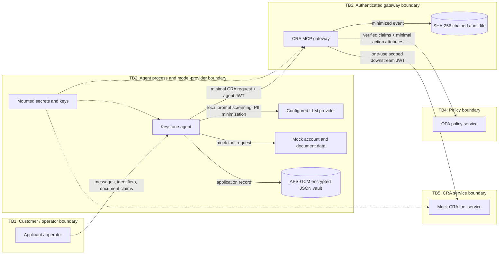
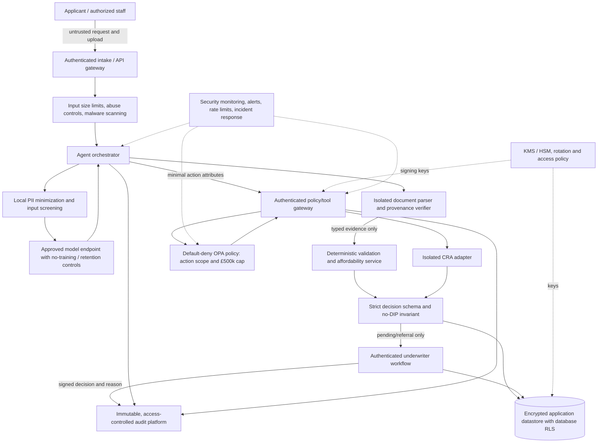

# Mortgage Agent Security Controls: M3–M5

This guide describes controls present in the mortgage-agent prototype and
distinguishes code-backed behavior from demonstration-only or production gaps.
The project uses synthetic data. These controls do not establish regulatory
compliance or readiness for live lending.

## M3 — Agent and application security

### Direct prompt injection

`KeystoneMortgageAgent.run_chat` checks customer input with the local
`LocalRebuffGuard` before invoking the language model. The guard checks direct
text and bounded Base64-encoded content against local attack patterns.
Responses are checked for a per-agent system-prompt canary before returning.
This pattern-based protection is not a complete prompt-injection defense.

Evidence: [`privacy.py`](privacy.py), [`agent.py`](agent.py),
[`test_mortgage_privacy.py`](../tests/test_mortgage_privacy.py).

### Indirect/document injection

In the assessment pipeline, strings from the document-ingestion result are
recursively checked by `ContentFilterMiddleware`. A detected instruction
returns `MANUAL_REVIEW_REQUIRED` before account lookup, CRA access,
affordability calculation, or storage. This is a mock document-ingestion
boundary: the project does not parse real uploads, verify issuer signatures,
or provide cryptographic document provenance.

Evidence: [`run_assessment_pipeline`](agent.py),
[`test_document_injection_stops_assessment_before_account_or_cra_calls`](../tests/test_mortgage_privacy.py).

### Strict decision output validation

`MortgageDecisionOutput` allows only `ESCALATE_TO_HUMAN_UNDERWRITER` and
`PENDING_HUMAN_REVIEW`, forbids unrecognized fields, and imposes a maximum
escalation threshold of £500,000. The decision output is validated before it
is used or stored. Automated DIP issuance is not an allowed outcome.

Evidence: [`MortgageDecisionOutput` and decision tool](lloyds_tools.py),
[pipeline validation](agent.py),
[schema tests](../tests/test_mortgage_privacy.py).

### £2m attack: simulated before versus secured controls

The “before” case is an explicitly simulated vulnerable example, not a real
approval or credit exposure. It illustrates how a naïve implementation might
trust injected instructions and fabricated income. The secured example
demonstrates the local prompt filter, document-result inspection, strict
decision schema, and £500,000 action policy. The outcome is a block/referral;
it does not issue a DIP. No live lender, customer, CRA, or lending decision is
involved.

The [generated notebook source](create_mortgageagent_nb.py) is the runnable
walkthrough. The [test suite](../tests/test_mortgage_privacy.py) verifies the
document injection stops before account/CRA calls and that an auto-approval
payload fails schema validation.

## M4 — Action policy and human escalation

The Rego policy allows only a standard, affordable request at or below
£500,000 with no adverse-credit flags. In external mode, the agent sends
minimal action attributes to an authenticated gateway route; the gateway
validates the agent JWT and asks OPA for the decision. Missing/invalid policy
decisions fail closed. Local mode uses an explicit mock policy for synthetic
demonstrations. An allow permits assessment only and never constitutes
approval; all outcomes remain pending/referral for human review.

Requests above £500,000, non-standard or adverse-credit cases, unaffordable
cases, explicit policy denials, and policy outages are escalated. The
prototype does not provide an authenticated underwriter queue or capture a
human's signed decision.

Evidence: [Rego policy and tests](../security/opa/keystone.rego),
[gateway route](cra_mcp_gateway.py), [gateway policy client](cra_gateway_policy.py),
[decision caller](lloyds_tools.py), [gateway integration tests](../tests/test_mcp_gateway.py).

## M5 — Data access, encryption, and audit

### Role- and tenant-scoped mock reads

The JSON-vault demonstration helper requires a principal with a known role and
filters records to the principal's `tenant_id`. Underwriters and privacy
officers may read a record; audit readers receive selected metadata only.
This is application-layer mock access, not database-enforced row-level
security. The helper is not an LLM tool, and production identity must be
constructed from authenticated claims rather than caller-supplied values.

Evidence: [`MockVaultPrincipal` and read helper](lloyds_tools.py),
[tenant/role tests](../tests/test_mortgage_privacy.py).

### Field and envelope encryption at rest

The vault encrypts the complete record using AES-256-GCM. NI numbers, bank
account identifiers, values under Lloyds account summaries, and CRA summary
fields are also encrypted as path-bound AES-GCM field envelopes before the
outer encryption. Both layers use the externally provisioned vault key.
Authenticated decryption rejects tampering or moving a field ciphertext to a
different JSON path.

This prototype does not use separate KMS-managed keys, a managed rotation or
revocation service, database RLS, or a retention/deletion workflow.

Evidence: [vault and field encryption](lloyds_tools.py),
[encryption tests](../tests/test_mortgage_privacy.py).

### Tamper-evident audit chain

The CRA gateway appends minimized request metadata to a SHA-256 hash chain.
The mortgage-action policy route is logged using an allowlisted action label;
the chain excludes applicant identifiers, tokens, request bodies, and CRA
payloads. Chain verification detects local edits relative to the retained
chain, but a privileged attacker who can rewrite the complete file can
recompute it. This is not external immutable storage or a complete mortgage
decision audit trail.

Evidence: [audit implementation](cra_gateway_audit.py),
[gateway route](cra_mcp_gateway.py), [tests](../tests/test_mcp_gateway.py).

## Threat-model scope and assumptions

This is a repository-grounded, qualitative threat model for the synthetic-data
prototype. It describes what exists in this checkout, not a penetration-test
result, assurance opinion, or production authorization to process real
applicant data. Risk scores are illustrative; owners must validate likelihood,
impact, and residual-risk acceptance against the deployed system.

### Data-flow diagram



**Trust-boundary notes**

| Boundary | Assets crossing it | Required control / prototype status |
|---|---|---|
| TB1 → agent | Customer instructions, identity details, document-derived values | Direct input screening and PII sanitization are implemented. The user remains untrusted; filtering is heuristic and not a complete injection defense. |
| Agent ↔ LLM provider | Prompt and model response | PII minimization is implemented in chat paths. Provider identity, retention, training use, residency, and contractual safeguards are deployment-specific and not established here. |
| Agent ↔ mock records/vault | Account/document-derived fields and stored assessment | Synthetic tools and AES-GCM vault are implemented. The JSON file and demo principal helper are not production database access controls. |
| Agent → gateway | CRA identifiers or mortgage-policy attributes plus bearer JWT | HTTPS is required off loopback; gateway checks JWT claims, route shape, and action scope. Hardened network configuration separates the agent from OPA and CRA service. |
| Gateway ↔ OPA | Verified identity/action attributes; no applicant identifiers | TLS and default-deny policies are configured in the hardened stack. OPA allow is scoped to assessment authority, never a loan approval. |
| Gateway → CRA service | CRA request and short-lived delegated token | Gateway-only network path, narrow tool allow-list, downstream token checks, and replay check are implemented; replay state is in-memory and not shared across replicas. |
| Processes ↔ secrets/audit | Signing keys, vault key, audit metadata | Compose mounts file-backed secrets. The local hash chain is tamper-evident, not immutable against a privileged full-file rewrite; external anchoring is absent. |

### Assets and security objectives

| Asset | Examples | Security objective | Classification / note |
|---|---|---|---|
| Applicant identity | Name, NI number, account number and sort code | Confidentiality, integrity, purpose-limited use | Highly sensitive personal/financial data; use synthetic values in this prototype. |
| Credit and affordability data | Credit score/flags, salary, debts, valuation, affordability result | Confidentiality, integrity, accuracy, traceability | Consequential profiling inputs; synthetic CRA/account records only. |
| Customer and document instructions | Chat, document-extraction strings, tool output | Integrity and instruction/data separation | Untrusted input; do not treat embedded instructions as system authority. |
| Decision/action state | Amount, affordability, profile, adverse flags, pending/referral result | Integrity, bounded authority, human oversight | No automated DIP/approval is an intended invariant. |
| Credentials and cryptographic keys | Agent JWT, gateway signing key, vault key, TLS keys | Confidentiality, integrity, least privilege, rotation | File-backed demo secrets; production key management and rotation are not present. |
| CRA tool access | CRA request, policy result, delegated token | Authorization, confidentiality, accountability | Mock CRA service and gateway; no live bureau integration. |
| Vault and audit records | Encrypted JSON envelope and gateway hash chain | Confidentiality, integrity, retention, availability | Vault encryption and local chain are implemented; deletion/retention and immutable audit archive are not. |
| Model/service availability | Agent, configured LLM, OPA, gateway, mock CRA | Availability and safe failure | Missing required sources or failed policy should stop/referral, not continue with defaults. |

### STRIDE threat analysis

| STRIDE class | Mortgage-agent threat scenario | Relevant boundary / asset | Current mitigation and residual gap |
|---|---|---|---|
| **Spoofing** | Forged agent identity, stolen JWT, or caller-supplied mock principal impersonates an authorized actor. | TB1/TB2/TB3; JWTs and application records | Gateway verifies RS256 issuer/audience/subject/scope and action-specific scope. Demo vault principal is not authenticated; no production identity provider, revocation, or managed credential rotation. |
| **Tampering** | Altered document claims, decision output, policy request, vault ciphertext, or audit entries. | TB1/TB2/TB3/TB4; evidence, action, records | Document strings are screened; policy inputs are schema-validated; strict decision schema rejects approval fields; AES-GCM authenticates vault data; audit chain detects local edits. No real upload provenance/signature validation, external audit anchoring, or full production integrity controls. |
| **Repudiation** | Applicant/operator or service denies a policy decision, CRA access, or later change to an assessment. | TB2/TB3; action and audit history | Gateway writes minimized hash-chained events. It does not record a complete decision lifecycle or a human reviewer identity/signature; a privileged actor can recompute a rewritten local chain. |
| **Information disclosure** | Prompt/model leakage, cross-tenant read, log exposure, credential theft, or access to plaintext personal data. | TB1/TB2/TB3/TB5; PII, keys, CRA response | Local redaction, minimized outputs, role/tenant mock filtering, encrypted vault, and PII-minimized audit. No database RLS, KMS/HSM, managed access review, production provider assurance, or external audit-storage controls. |
| **Denial of service** | Oversized/encoded prompts, repeated tool calls, or unavailable model/OPA/CRA service exhausts resources or blocks processing. | TB1/TB2/TB3/TB4; service availability | Bounded inspection/request sizes, timeouts, container resource limits, and fail-closed paths exist. No demonstrated rate limiting, autoscaling/recovery objectives, or operational manual-review continuity plan. |
| **Elevation of privilege** | Prompt injection induces an unauthorized action, CRA call, automated approval, or bypass of the £500k authority boundary. | TB1→TB2→TB3/TB4; decision/action and CRA access | Injection checks, least-scoped gateway routes/tokens, OPA action policy, strict pending/referral schema, and no-DIP rule. Heuristic filters are bypassable; no production approval workflow or independent adversarial assurance exists. |

## Threat-framework mapping

Mappings below link framework concepts to the mortgage-agent attack surface
and tested controls. They are coverage pointers, not claims that a framework
assessment is complete. MITRE ATLAS names are used as conceptual technique
descriptions; verify technique identifiers and applicability against the
current ATLAS release during formal threat-model review.

| Threat / attack path | STRIDE | OWASP LLM Top 10 (2025) | MITRE ATLAS concept | Control / evidence | Residual risk |
|---|---|---|---|---|---|
| Direct user prompt changes instructions or elicits protected information | Tampering, elevation, disclosure | LLM01 Prompt Injection; LLM07 System Prompt Leakage; LLM02 Sensitive Information Disclosure | LLM prompt injection / jailbreak | [`LocalRebuffGuard`](privacy.py), [`run_chat`](agent.py), [tests](../tests/test_mortgage_privacy.py) | Pattern-based detection can miss novel or obfuscated attacks; canary detects only some response leakage. |
| Instructions embedded in document/tool output | Tampering, elevation | LLM01 Prompt Injection; LLM04 Data and Model Poisoning | Indirect prompt injection through retrieved or supplied content | Recursive document-result scan and stop before account/CRA calls: [`agent.py`](agent.py), [test](../tests/test_mortgage_privacy.py) | Mock extracted strings only; no real file parser, OCR isolation, issuer authenticity, or signed provenance verification. |
| Model/tool produces an unauthorized approval or action | Elevation, tampering | LLM05 Improper Output Handling; LLM06 Excessive Agency; LLM09 Misinformation | LLM output manipulation leading to unauthorized action | [`MortgageDecisionOutput`](lloyds_tools.py), pipeline schema check [`agent.py`](agent.py), no-DIP test | Schema gate is local prototype code; no independent action service or production human sign-off. |
| Over-limit or exceptional mortgage action is requested | Elevation, tampering | LLM06 Excessive Agency; LLM05 Improper Output Handling | Abuse of model-integrated application/API | [OPA Rego rule](../security/opa/keystone.rego), [gateway policy route](cra_mcp_gateway.py), [policy tests](../security/opa/keystone_test.rego) | Local mode is mock by default; Compose selects external mode. An allow only permits assessment; underwriter process is not operational. |
| CRA tool access is replayed, forged, or broadened | Spoofing, elevation, repudiation | LLM06 Excessive Agency; LLM02 Sensitive Information Disclosure | Abuse of ML/application API credentials and access | [JWT validation](cra_gateway_auth.py), [gateway](cra_mcp_gateway.py), [network policy](../docker-compose.hardened.yml) | Demo credentials lack managed issuance/revocation; replay state is process-local. |
| Applicant identifiers leak through prompts, results, or logs | Disclosure | LLM02 Sensitive Information Disclosure; LLM07 System Prompt Leakage | Exfiltration of sensitive data through model/application interface | [PII sanitizer](privacy.py), minimized tools [`lloyds_tools.py`](lloyds_tools.py), [audit](cra_gateway_audit.py) | Redaction is not guaranteed complete; provider retention and operational logs require separate review. |
| Forged income/document data distorts assessment | Tampering, repudiation | LLM04 Data and Model Poisoning; LLM09 Misinformation | Poisoning or manipulation of data supplied to an AI-enabled system | [Status/schema/input validation](agent.py), manual-review fallback | No production issuer-backed provenance or independently validated bank-feed grounding; mock records cannot show fraud detection efficacy. |
| Vault or audit record is modified or exposed | Tampering, disclosure, repudiation | LLM02 Sensitive Information Disclosure; LLM03 Supply Chain (deployment dependency risk) | Data exfiltration or impairment of AI application assets | [AES-GCM vault](lloyds_tools.py), [hash-chain audit](cra_gateway_audit.py), hardened Compose | Same vault key at field/envelope layers; no managed KMS, database RLS, immutable external logging, or demonstrated backup/recovery. |
| Prompt/tool workload causes resource exhaustion | Denial of service | LLM10 Unbounded Consumption | Denial of service against an AI-enabled service | Bounded scanner/request sizes, timeouts, and [container resource limits](../docker-compose.hardened.yml) | No rate-limit/load-test results, abuse monitoring, or recovery objectives. |
| Vulnerable dependencies or compromised build/runtime component | Spoofing, tampering, availability | LLM03 Supply Chain | Supply-chain compromise of AI software or dependencies | [Pinned requirements](../requirements.txt), [hardened image](../Dockerfile.hardened) | Pinning is not provenance verification; no repeatable signed build, dependency gate, or verified image attestation demonstrated. |

## Risk ranking and Threat → Control mapping

The order below is generated from `build_mortgage_risk_register()` using
likelihood × impact (1–5 each), sorted by residual score, then inherent score.
Scores and ratings are illustrative and must be accepted or changed by the
named accountable owners. Controls reduce modeled risk; they do not prove
compliance or operational effectiveness.

| Rank | Risk ID / scenario | Inherent L×I = score | Residual L×I = score | Rating | Primary threat/control mapping | Owner / required next action |
|---:|---|---:|---:|---|---|---|
| 1 | KMR-01 — unfair or discriminatory lending outcomes | 4×5 = 20 | 4×5 = 20 | Critical | Decision/data integrity; fairness validation is not evidenced. | Model Risk / Fair Lending — validate outcomes across relevant groups and independently review thresholds. |
| 2 | KMR-02 — incorrect or unsupported lending decision | 4×5 = 20 | 3×5 = 15 | High | Output schema, affordability checks, pending/referral-only policy; no authenticated human approval. | Mortgage Product / Model Risk — validate/calibrate outcomes and retain issuance block until recorded review exists. |
| 3 | KMR-03 — unauthorized disclosure or misuse of applicant data | 4×5 = 20 | 2×4 = 8 | Medium | PII minimization, encryption, tenant mock reads, gateway scoping; no KMS/database RLS/provider assurance. | Data Protection / Security — test retention/deletion, access reviews, key rotation, incidents, and provider handling. |
| 4 | KMR-04 — prompt injection or protected-record exfiltration | 4×5 = 20 | 2×4 = 8 | Medium | Direct/indirect screening, schema gate, least-privilege tools; heuristic and adversarial coverage gaps. | AI Security — expand adversarial testing and retest after model, prompt, or tool changes. |
| 5 | KMR-05 — fraudulent or manipulated applicant evidence | 3×5 = 15 | 2×4 = 8 | Medium | Mock output validation and injection scan; no authenticated provenance or independently validated grounding. | Financial Crime / Mortgage Operations — implement trusted provenance, source validation, and discrepancy referral. |
| 6 | KMR-07 — service outage or unsafe fallback | 3×3 = 9 | 2×3 = 6 | Medium | Fail-closed validation/policy paths; recovery and manual continuity untested. | Mortgage Operations / SRE — set recovery objectives, alerting, and safe manual processing procedures. |
| 7 | KMR-06 — unauthorized or excessive CRA access | 3×5 = 15 | 1×5 = 5 | Medium | JWT, scoped delegation, OPA default deny, network separation; production credential lifecycle and shared replay protection absent. | Platform Security — exercise rotation, policy change control, alerting, and multi-instance replay protection. |

### £500,000 action boundary and escalation rules

The authoritative threshold is
`HUMAN_MANDATE_ESCALATION_THRESHOLD_GBP = 500000.0` in
[`lloyds_tools.py`](lloyds_tools.py) and the external OPA rule in
[`keystone.rego`](../security/opa/keystone.rego). The boundary is inclusive
for policy evaluation: exactly £500,000 may pass the policy predicate if all
other conditions pass; **any amount above £500,000 must be referred**.
Passing the predicate is permission to continue an assessment only, never
approval or DIP issuance.

| Condition | Required system outcome |
|---|---|
| Amount > £500,000 | Refer to senior mortgage mandate underwriter; do not auto-approve or issue a DIP. |
| Amount ≤ £500,000, standard profile, affordability passed, no adverse flags, score ≥ 700, policy allows | `PENDING_HUMAN_REVIEW`; authorized human decision still required. |
| Adverse flags > 0 or score < 700 | Refer to senior credit-risk underwriter. |
| Non-standard employment/profile | Refer to specialist underwriter. |
| Affordability failure | Refer for review; do not represent the request as an offer or approval. |
| Policy denial, policy timeout/unavailability, invalid/missing evidence, or detected document injection | Fail closed and refer/manual-review; do not proceed on a permissive fallback. |

The decision logic and tests are in
[`evaluate_decision_authority`](lloyds_tools.py) and
[`test_mortgage_privacy.py`](../tests/test_mortgage_privacy.py); the external
policy is tested in [`keystone_test.rego`](../security/opa/keystone_test.rego).
The referral is a software status, not a staffed queue, SLA, or recorded human
underwriting action.

## Secure reference architecture

The following target architecture separates untrusted content, model
reasoning, policy enforcement, data services, and human authority. Solid
components have prototype code; the right-hand operational controls are
recommended production requirements, not implemented services.



**Minimum production hardening before real applicant processing**

1. Replace demo JSON storage and caller-built principals with an approved
   database, authenticated service identity, database-enforced tenant/role
   controls, and independently reviewed field access.
2. Use managed key storage/rotation and separate encryption/signing key
   domains; test restore, deletion, retention, and revocation.
3. Use a provider-approved LLM endpoint with reviewed data retention/training
   terms; minimize/redact model-bound data and prevent secrets or raw
   documents from entering prompts.
4. Parse uploads in an isolated service; validate file type/size, malware,
   issuer/source authenticity and extracted fields. Treat OCR/document
   content as untrusted data and route verification failures to a human.
5. Keep OPA default-deny, restrict policy-service network access, use action-
   specific JWT scopes, require an independently authenticated policy call,
   and add deployment-tested replay protection and credential lifecycle
   management.
6. Preserve the no-automated-DIP invariant. Provide an authenticated human
   workflow that records reviewer identity, evidence, rationale, decision,
   timestamp, and customer communication before any lending action.
7. Export audit events to separately administered immutable storage; monitor
   policy denials, injection attempts, abnormal access, outages, and data
   export. Establish tested response, backup, recovery, and rate-limit plans.
8. Run independent STRIDE/ATLAS threat review, application penetration test,
   adversarial LLM evaluation, privacy/fairness assessments, and regulatory
   sign-off on the actual deployed architecture.

## Verification

From the repository root, run:

```powershell
python -B -m unittest tests.test_governance tests.test_mortgage_privacy tests.test_mcp_gateway -v
opa test security\opa -v
```

The controls are prototype evidence only. Real CRA/provider integration,
independent security testing, a production authorization design, a real
underwriter workflow, privacy/legal approval, and externally anchored audit
retention remain launch prerequisites.
